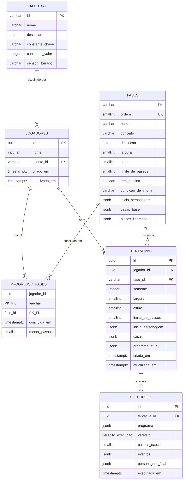

# Modelagem de Banco de Dados — Almanak

Documento da [issue #47](https://github.com/lluuiizz/Almanak/issues/47). O desenho é o mesmo da [#52](https://github.com/lluuiizz/Almanak/issues/52): tabelas, chaves, tipos e o que o backend faz com cada uma. O schema executável está em `src/database/init/01-schema.sql`. Os tipos de domínio estão em `src/backend/src/tipos.ts`.

## 1. Premissas

1. O SGBD é PostgreSQL 15 (`postgres:15-alpine` no `docker-compose.yml`).
2. O banco fica na rede interna `backend_net`, junto com o backend. O frontend não alcança o `db`.
3. O servidor é a fonte da verdade. Ele abre a tentativa, guarda o mapa daquela semente, recebe o programa, executa e devolve eventos e veredito.
4. Mapa, paleta e árvore de blocos ficam em `JSONB`, no mesmo formato que o TypeScript lê e grava. Não há uma tradução extra entre a API e a coluna.

## 2. Diagrama entidade-relacionamento



Há ainda o tipo enumerado `direcao_olhar` (`norte`, `leste`, `sul`, `oeste`). Nenhuma coluna o usa. O olhar do personagem mora dentro do JSON de `inicio_personagem` e de `personagem_final`, com esses mesmos quatro valores.

## 3. Dicionário de dados

`NN` significa `NOT NULL`. Onde a coluna tem `DEFAULT`, o insert pode omiti-la.

### talentos

Constante permanente do jogador. A fase 11 escolhe uma e ela não volta a ser reatribuída.

| Coluna | Tipo | Nulo | Chave | Regra |
| --- | --- | --- | --- | --- |
| id | `VARCHAR(50)` | NN | PK | Ex.: `pulso_firme`, `olhar_atento` |
| nome | `VARCHAR(100)` | NN | | Nome do medalhão |
| descricao | `TEXT` | NN | | Regra do talento |
| constante_chave | `VARCHAR(50)` | sim | | Ex.: `DANO_TALENTO`. O programa não pode escrever nessa constante |
| constante_valor | `INTEGER` | sim | | Valor somente leitura. Ex.: `1` |
| sensor_liberado | `VARCHAR(50)` | sim | | Sensor que o talento libera para sempre. Ex.: `armadilha_frente` |

### jogadores

Um progresso local. O seed cria o jogador `00000000-0000-0000-0000-000000000001`.

| Coluna | Tipo | Nulo | Chave | Regra |
| --- | --- | --- | --- | --- |
| id | `UUID` | NN | PK | `DEFAULT gen_random_uuid()` |
| nome | `VARCHAR(100)` | NN | | `DEFAULT 'Jogador Local'` |
| talento_id | `VARCHAR(50)` | sim | FK → `talentos.id` | `ON DELETE SET NULL`. Fica nulo até a escolha do talento |
| criado_em | `TIMESTAMPTZ` | NN | | `DEFAULT NOW()` |
| atualizado_em | `TIMESTAMPTZ` | NN | | `DEFAULT NOW()` |

Vida e ataque não são colunas do jogador. Nascem de `fases.inicio_personagem` em cada tentativa.

### fases

Catálogo das doze fases. A `ordem` é única e vale de 1 a 12.

| Coluna | Tipo | Nulo | Chave | Regra |
| --- | --- | --- | --- | --- |
| id | `VARCHAR(30)` | NN | PK | Ex.: `fase-1` |
| ordem | `SMALLINT` | NN | UK | `CHECK (ordem >= 1 AND ordem <= 12)` |
| nome | `VARCHAR(100)` | NN | | Ex.: Tutorial |
| conceito | `VARCHAR(100)` | NN | | Ex.: Sequência |
| descricao | `TEXT` | sim | | Texto curto da fase |
| largura | `SMALLINT` | NN | | `CHECK (largura > 0)` |
| altura | `SMALLINT` | NN | | `CHECK (altura > 0)` |
| limite_de_passos | `SMALLINT` | NN | | `DEFAULT 8`. `CHECK (> 0)`. Corta repetição sem fim |
| tem_neblina | `BOOLEAN` | NN | | `DEFAULT FALSE`. Verdadeiro na fase 5 |
| condicao_de_vitoria | `VARCHAR(50)` | NN | | `DEFAULT 'chegar_no_destino'` |
| inicio_personagem | `JSONB` | NN | | Personagem no início da fase |
| casas_base | `JSONB` | NN | | Grade modelo, antes do sorteio da tentativa |
| blocos_liberados | `JSONB` | NN | | Paleta permitida |

### progresso_fases

Fases já concluídas por um jogador. A chave primária impede concluir a mesma fase duas vezes. Um novo recorde só atualiza `menor_passos`.

| Coluna | Tipo | Nulo | Chave | Regra |
| --- | --- | --- | --- | --- |
| jogador_id | `UUID` | NN | PK, FK → `jogadores.id` | `ON DELETE CASCADE` |
| fase_id | `VARCHAR(30)` | NN | PK, FK → `fases.id` | `ON DELETE CASCADE` |
| concluida_em | `TIMESTAMPTZ` | NN | | `DEFAULT NOW()` |
| menor_passos | `SMALLINT` | sim | | `CHECK (menor_passos > 0)` |

### tentativas

Uma abertura de fase. O mapa e o personagem inicial são copiados na abertura e não mudam nos Plays seguintes. A semente fica gravada para o mesmo sorteio valer em toda a tentativa.

| Coluna | Tipo | Nulo | Chave | Regra |
| --- | --- | --- | --- | --- |
| id | `UUID` | NN | PK | `DEFAULT gen_random_uuid()` |
| jogador_id | `UUID` | NN | FK → `jogadores.id` | `ON DELETE CASCADE` |
| fase_id | `VARCHAR(30)` | NN | FK → `fases.id` | `ON DELETE CASCADE` |
| semente | `INTEGER` | NN | | `DEFAULT 1` |
| largura | `SMALLINT` | NN | | `CHECK (> 0)`. Cópia da fase na abertura |
| altura | `SMALLINT` | NN | | `CHECK (> 0)` |
| limite_de_passos | `SMALLINT` | NN | | `CHECK (> 0)` |
| inicio_personagem | `JSONB` | NN | | Estado inicial desta tentativa |
| casas | `JSONB` | NN | | Mapa já resolvido com a semente |
| programa_atual | `JSONB` | NN | | `DEFAULT '[]'`. Último programa aceito |
| criada_em | `TIMESTAMPTZ` | NN | | `DEFAULT NOW()` |
| atualizada_em | `TIMESTAMPTZ` | NN | | `DEFAULT NOW()` |

Índice: `idx_tentativas_jogador_fase (jogador_id, fase_id)`.

### execucoes

Um Play aceito. Programa recusado pela fase não gera linha e não altera `casas` nem `inicio_personagem`.

| Coluna | Tipo | Nulo | Chave | Regra |
| --- | --- | --- | --- | --- |
| id | `UUID` | NN | PK | `DEFAULT gen_random_uuid()` |
| tentativa_id | `UUID` | NN | FK → `tentativas.id` | `ON DELETE CASCADE` |
| programa | `JSONB` | NN | | Árvore enviada naquele Play |
| veredito | `veredito_execucao` | NN | | Enum abaixo |
| passos_executados | `SMALLINT` | NN | | `DEFAULT 0`. Quantidade de eventos |
| eventos | `JSONB` | NN | | Lista ordenada para a animação |
| personagem_final | `JSONB` | NN | | Personagem ao fim. Na falha, volta ao início |
| executada_em | `TIMESTAMPTZ` | NN | | `DEFAULT NOW()` |

Índice: `idx_execucoes_tentativa (tentativa_id)`.

`veredito_execucao`: `sem_vitoria`, `vitoria`, `parede`, `inimigo`, `vida_zerada`, `limite_de_passos`.

## 4. O que vai dentro do JSON

Os objetos seguem `src/backend/src/tipos.ts`. A árvore completa, com `se`, laços e rotina, é a de `src/backend/src/arvore.ts`.

Personagem (`inicio_personagem` e `personagem_final`):

```json
{
  "posicao": { "x": 0, "y": 0 },
  "olhar": "leste",
  "vida": 1,
  "ataque": 1,
  "alforje": []
}
```

`olhar` é `norte`, `leste`, `sul` ou `oeste`.

Casa (`casas_base` e `casas`), uma lista em ordem de linha:

```json
{ "tipo": "vazio", "marco": true }
```

`tipo` é `vazio`, `parede`, `destino`, `inimigo`, `item`, `porta`, `espinhos` ou `armadilha`. `marco`, `resistencia`, `dano` e `conteudo` são opcionais.

Ação liberada na fase 1:

```json
{ "tipo": "mover", "direcao": "direita" }
```

Também existem `virar`, `avancar`, `atacar` e `pegar`. Um evento de execução é `{ "bloco", "personagem", "veredito" }`.

## 5. Regras do backend sobre esse modelo

O motor e a API aplicam o seguinte. O banco guarda o resultado. Não é uma constraint em todas as linhas.

- Abrir uma tentativa copia `casas_base` e `inicio_personagem` da fase e grava a semente. Outro Play na mesma tentativa usa essas colunas de novo.
- Só um programa aceito atualiza `programa_atual` e insere em `execucoes`. Bloco fora da paleta, sensor no corpo de uma ação, ação no lugar da pergunta ou escrita em `DANO_TALENTO` não gravam nada.
- `vitoria` insere ou atualiza `progresso_fases`. Os outros vereditos não marcam a fase como concluída.
- Na falha, `personagem_final` é o início da tentativa. Na vitória, é o personagem em cima do destino.
- O talento do jogador não é apagado no Play. Vida e ataque da tentativa seguinte nascem outra vez do início da fase.
- A fase 1 só executa uma lista plana de movimentos. O JSON já aceita a árvore das fases seguintes. O motor dessas fases ainda não está nesta sprint.

## 6. Arquivos

- `src/database/init/01-schema.sql` cria a extensão `pgcrypto`, os enums, as tabelas e os índices.
- `src/database/init/02-seeds.sql` carrega os dois talentos, o jogador local e a fase 1.
- O Compose monta essa pasta em `/docker-entrypoint-initdb.d`. Os scripts rodam quando o volume do Postgres nasce vazio.
