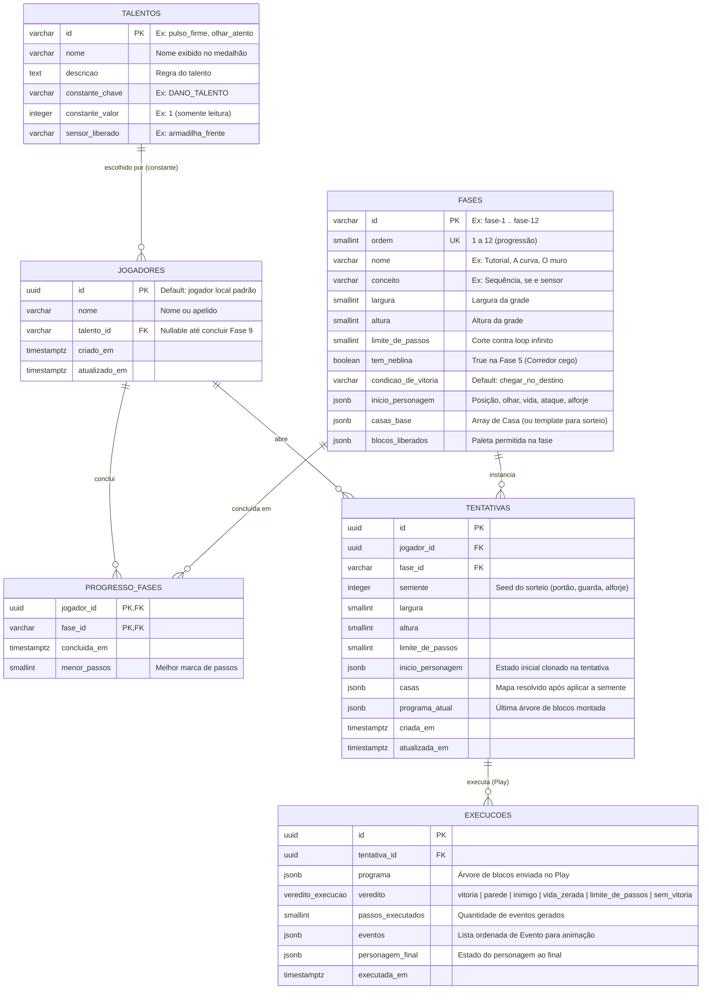

# Modelagem de Banco de Dados — Almanak

Esta modelagem foi construída a partir do `README.md`, do planejamento em `docs/sprints.md` (Issues `#52`, `#53` e `#54`) e dos tipos implementados no backend em `src/backend/src/tipos.ts` e `src/backend/src/fase1.ts`.

## 1. Premissas de Arquitetura

1. **SGBD:** PostgreSQL 15 (`postgres:15-alpine` definido no `docker-compose.yml`).
2. **Isolamento de rede:** O banco (`db`) fica na rede interna `backend_net` junto com o `backend`. O container `frontend` fica apenas na rede `frontend_net`, sem acesso direto ao banco de dados.
3. **Servidor como fonte da verdade:** O servidor sorteia a tentativa (`semente`), armazena o mapa instanciado, recebe a árvore de blocos (`programa`), executa e devolve a lista de `eventos` e o `veredito`.
4. **Uso estratégico de `JSONB`:** A grade do mapa (`casas`), a paleta de blocos (`blocos_liberados`) e a árvore do programa (`programa` — que a partir da Fase 3 possui aninhamento com `se/senão`, `enquanto`, `repetir` e `rotinas`) são armazenadas em `JSONB`, mantendo compatibilidade direta com as interfaces `Fase`, `Tentativa` e `Resultado` do TypeScript.

---

## 2. Diagrama Entidade-Relacionamento (DER)

---

## 3. Estrutura de Arquivos do Banco

- `src/database/init/01-schema.sql`: Criação de extensões, tipos enumerados (`direcao_olhar`, `veredito_execucao`), tabelas e índices.
- `src/database/init/02-seeds.sql`: Carga inicial dos talentos, jogador padrão e Fase 1 (*Tutorial*).

Ambos os arquivos são montados automaticamente em `/docker-entrypoint-initdb.d` quando o container `almanak-db` é inicializado pelo `docker compose up`.

